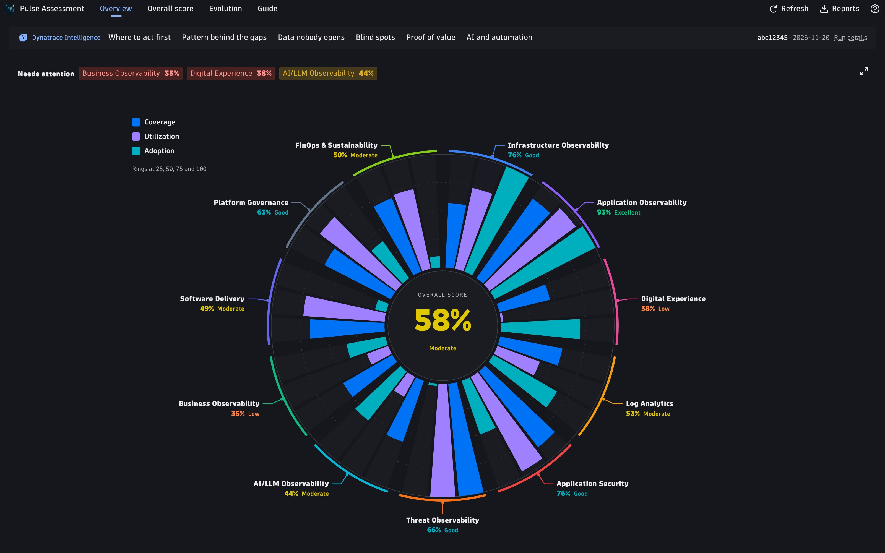
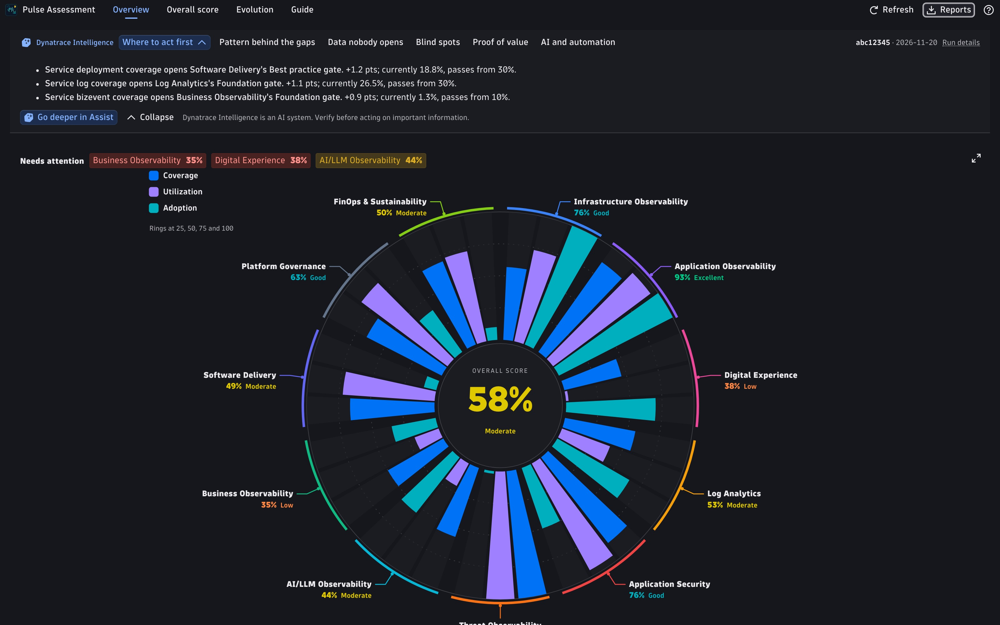
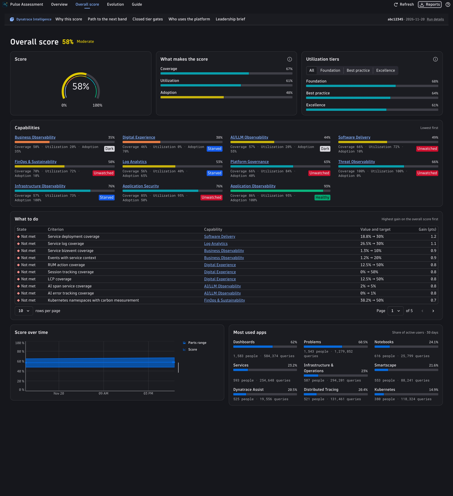
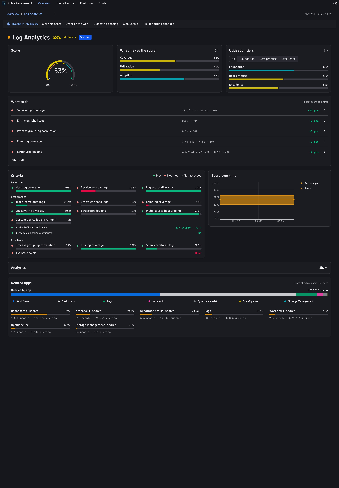
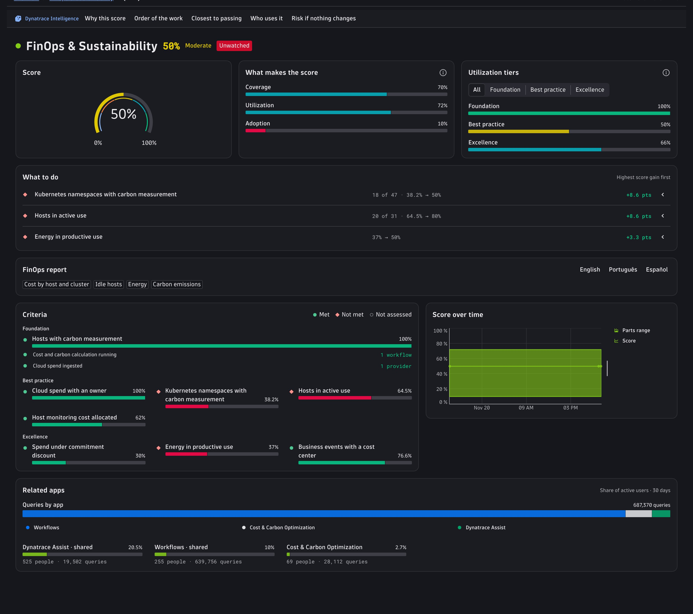
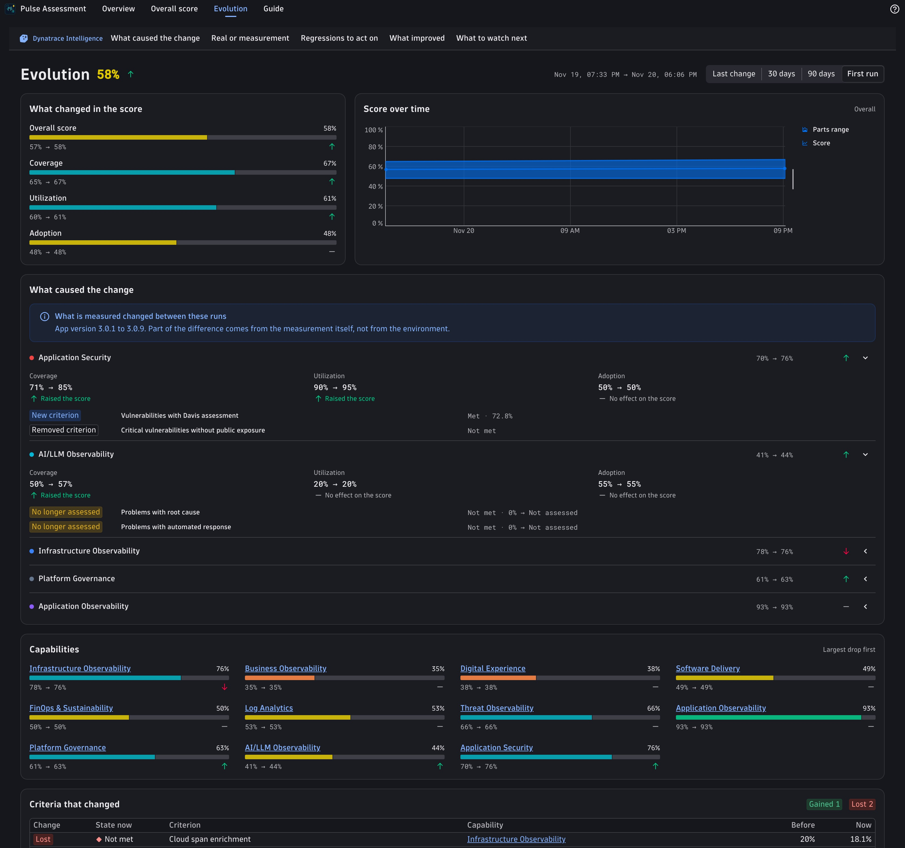
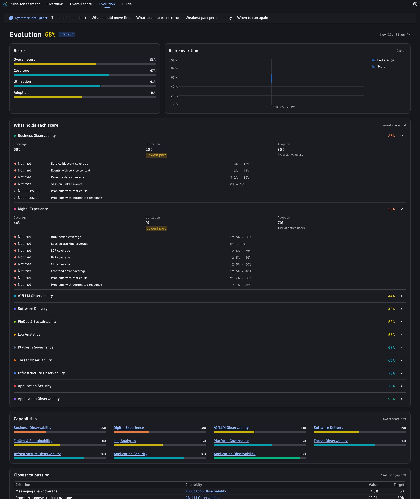
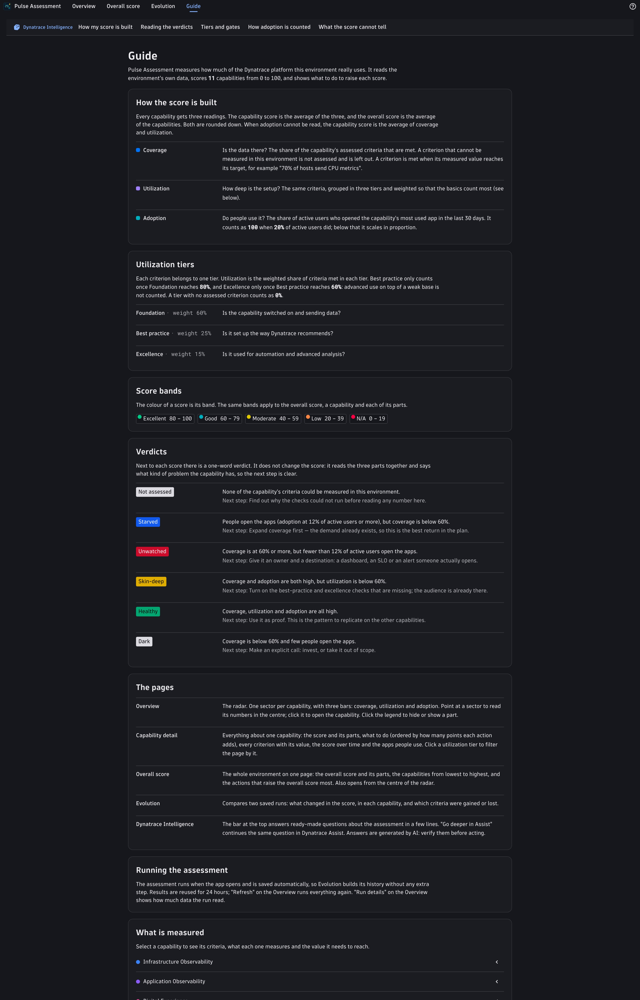
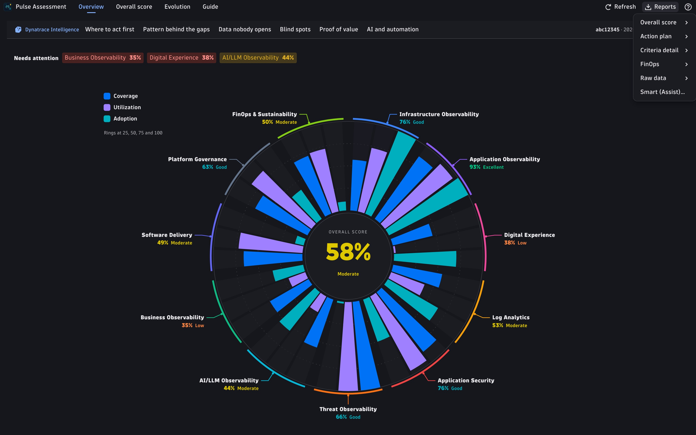
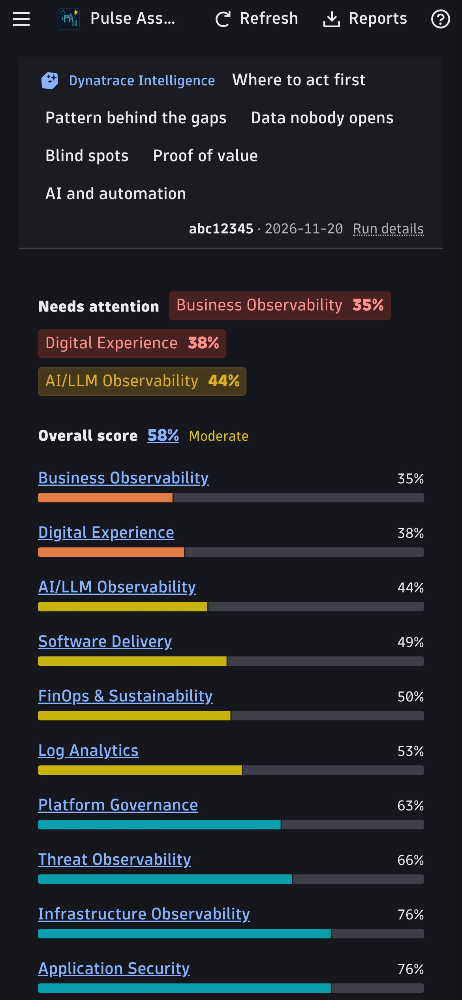

# Pulse Assessment

> How well is this environment actually using Dynatrace? One run answers it from the tenant's own data.

Pulse Assessment is a native **Dynatrace App** that scores an environment's observability posture across **11 capabilities** and **143 criteria**, read with DQL against Grail and with the platform's settings and SLO services. Every capability gets one score built from three parts — **coverage**, **utilization** and **adoption** — plus a verdict, the criteria that fail, the action that fixes each one, and how the score moved since the last run.

---

## Features

- **Runs on open** — the app opens on the assessment; there is no start page. A run from the last 24 hours is served from a cache at zero Grail cost
- **Three-part score** — each capability score is the average of coverage, utilization and adoption (see below). Percentages are floored, never rounded up
- **Verdict per capability** — a named diagnosis (for example data nobody opens, or usage ahead of coverage) instead of a bare number
- **Four pages** — Overview (radar and capabilities), Overall score, Evolution and Guide, plus a detail page per capability
- **Guided remediation** — the action and the documentation link for every unmet criterion, with the points the score gains
- **Evolution** — every completed run is saved (one per day kept for 90 days); the page compares the latest run with a baseline and traces each change to its part and its criteria. On the first run the page reads that run as the baseline: what holds each score and which criteria are closest to passing
- **Dynatrace Intelligence on every page** — page-specific questions answered by Davis CoPilot from the numbers on screen; one answer costs 3 AI Units and nothing is asked until you click
- **Reports** — the Overall score PDF carries the Overview radar. Overall, Action plan and Criteria PDFs in English, Portuguese and Spanish (criterion names, descriptions and actions are translated; capability names stay as Dynatrace writes them), a FinOps report, a Smart Report written by Davis CoPilot, and raw data as JSON or CSV
- **Works on any licensing model** — without Traces on Grail it switches to Trace Proxy Mode (metric and topology equivalents for span checks; checks with no honest proxy leave the score). Without the classic entity model it reads Smartscape
- **Not assessed is not failed** — a criterion that cannot be measured in the environment is left out of the score and named as such
- **Dark/Light theme** — Dynatrace Strato components and design tokens throughout

## Screenshots

**Overview** — the overall score and, per capability, coverage, utilization and adoption on one radar.



**Dynatrace Intelligence** — page-specific questions answered from the numbers on screen.



**Overall score** — what makes the score, the utilization tiers, every capability with its verdict, and the criteria to act on.



**Capability detail** — the three parts, the actions with the points each one adds, and every criterion by tier.



**FinOps & Sustainability** — the capability page offers the FinOps report directly.



**Evolution** — the latest run against a baseline, with each change traced to its part and its criteria.



**Evolution on the first run** — the baseline: what holds each score and which criteria are closest to passing.



**Guide** — how the score is built, in the app itself.



**Reports** — PDFs in three languages, FinOps, raw data and the Smart Report.



**Narrow screens** — the capabilities as a list.



## 11 capabilities assessed

| Capability | Criteria | Tiers (F / BP / E) |
|---|---|---|
| Infrastructure Observability | 26 | 3 / 13 / 10 |
| Application Observability | 15 | 3 / 6 / 6 |
| Digital Experience | 15 | 3 / 7 / 5 |
| Log Analytics | 16 | 3 / 9 / 4 |
| Application Security | 7 | 1 / 5 / 1 |
| Threat Observability | 4 | 1 / 2 / 1 |
| AI/LLM Observability | 16 | 3 / 5 / 8 |
| Business Observability | 10 | 3 / 4 / 3 |
| Software Delivery | 6 | 1 / 2 / 3 |
| Platform Governance | 18 | 1 / 13 / 4 |
| FinOps & Sustainability | 10 | 3 / 4 / 3 |
| **Total** | **143** | **25 / 70 / 48** |

## Scoring model

**Capability score = floor(average of coverage, utilization and adoption).** The overall score is the floored average of the capability scores.

| Part | What it measures |
|---|---|
| Coverage | Share of the assessed criteria that are met |
| Utilization | Tiered progress: Foundation 60%, Best Practice 25%, Excellence 15%. Best Practice counts only once Foundation reaches 80%, Excellence only once Best Practice reaches 60% |
| Adoption | Distinct users opening the Dynatrace apps behind the capability, as a share of the platform's active users. 20% of active users is a full score |

A share criterion is met at the middle of its three thresholds. When adoption cannot be read, the score uses the parts that can.

## Prerequisites

- **Node.js** 20+ (recommended: 22 LTS or later)
- **npm** 10+ (ships with Node.js 20+)
- **Dynatrace App Toolkit** (`dt-app` CLI v1.8+) — install via `npm install -g dt-app`
- Access to a Dynatrace SaaS tenant with Grail (Dynatrace Managed has no Grail)
- VSCode with the [Dynatrace Apps extension](https://marketplace.visualstudio.com/items?itemName=dynatrace.dynatrace-extensions) (recommended)

> **Important:** Verify your Node.js version before starting: `node --version` (must be ≥ v20).

## Quick Start

### TL;DR (3 commands)
```bash
git clone https://github.com/mbdccoletta/Pulse-Assessment-App.git
cd Pulse-Assessment-App
# Edit app.config.json → set your environmentUrl
./setup.sh
```

The `setup.sh` script validates prerequisites (Node.js ≥ 20, npm ≥ 10), checks your tenant config, installs dependencies with `npm ci`, and verifies the `dt-app` CLI. After setup, run `npm run start` (dev) or `npm run deploy` (production).

<details>
<summary>Manual step-by-step instructions</summary>

### 1. Verify prerequisites
```bash
node --version   # Must be >= v20
npm --version    # Must be >= 10
```

### 2. Clone the repository
```bash
git clone https://github.com/mbdccoletta/Pulse-Assessment-App.git
cd Pulse-Assessment-App
```

### 3. Configure your tenant
Edit `app.config.json` and set your environment URL:
```json
"environmentUrl": "https://YOUR_TENANT_ID.apps.dynatrace.com"
```

### 4. Install dependencies
```bash
npm ci
```

> **Use `npm ci`, not `npm install`.** This installs exact versions from `package-lock.json`, ensuring everyone gets the same dependency tree and avoiding version mismatch errors.

> **Never delete `package-lock.json`** — it pins the exact dependency versions that are tested and guaranteed to work.

### 5. Verify installation
```bash
npx dt-app --version   # Should show dt-app CLI version
```

### 6. Run locally (dev mode)
```bash
npm run start
```
Opens in browser connected to your tenant with hot reload.

### 7. Deploy to production
```bash
npm run build
npm run deploy
```

</details>

> **After every `git pull`**, always run `npm ci` again to pick up any dependency changes.

## Required Scopes

The app requests 17 scopes (configured in `app.config.json`):

| Scope | Purpose |
|---|---|
| `storage:entities:read` | Entity queries (hosts, services, apps) |
| `storage:smartscape:read` | Smartscape nodes and edges, for environments without the classic entity model |
| `storage:logs:read` | Log Analytics criteria |
| `storage:metrics:read` | Infrastructure metrics (timeseries) |
| `storage:spans:read` | Application and AI/LLM Observability tracing |
| `storage:events:read` | Security, delivery and problem events |
| `storage:security.events:read` | Vulnerabilities, detections and compliance findings |
| `storage:bizevents:read` | Business Observability events |
| `storage:buckets:read` | Grail bucket access for DQL |
| `storage:system:read` | System tables (usage and adoption) |
| `settings:objects:read` | Configuration reads (anomaly detectors, log pipelines, classic SLOs, masking and privacy settings) |
| `slo:slos:read` | Count of SLOs in the Service-Level Objectives app |
| `app-engine:apps:run` | Installed app names for the adoption reading |
| `davis-copilot:conversations:execute` | Dynatrace Intelligence answers and the Smart Report |
| `document:documents:read` | Load saved runs and the query cache |
| `document:documents:write` | Save runs and the query cache |
| `document:documents:delete` | Remove runs past retention |

## Project Structure

```
├── app.config.json               # App manifest (version, scopes)
├── ui/
│   ├── main.tsx                  # Entry point
│   └── app/
│       ├── App.tsx               # Routes, the single score, run history save
│       ├── appVersion.ts         # Must match app.config.json
│       ├── queries.ts            # The 143 criteria
│       ├── pulseScore.ts         # Coverage + utilization + adoption
│       ├── diagnosis.ts          # Verdict per capability
│       ├── remediationActions.ts # Action and link per criterion
│       ├── trace-proxy.ts        # Catalog without Traces on Grail
│       ├── entity-model.ts       # Catalog on Smartscape
│       ├── log-metric.ts         # Log criteria from the free log metric
│       ├── ai/                   # Prompts and page intelligence
│       ├── reports/              # PDF, JSON and CSV reports
│       ├── perf/                 # 24h query cache
│       ├── components/ data/ hooks/ pages/ utils/
├── tools/gen-criteria-summary.mjs # Regenerates docs/CRITERIA-SUMMARY.md from the catalog
└── docs/                         # Architecture, criteria, scoring, design system, data sources
```

See [docs/ARCHITECTURE.md](docs/ARCHITECTURE.md) for the architecture and data flow, [docs/SCORING-CALCULATIONS.md](docs/SCORING-CALCULATIONS.md) for the scoring rules with worked examples, and [docs/CRITERIA-SUMMARY.md](docs/CRITERIA-SUMMARY.md) for every criterion and its pass line.

## Tech Stack

| Technology | Purpose |
|---|---|
| React 18 + TypeScript | UI |
| Dynatrace Strato | Components, charts and design tokens |
| jsPDF | PDF reports |
| DQL, Settings and SLO services | Readings |
| Davis CoPilot | Page intelligence and the Smart Report |
| dt-app CLI | Build, dev, deploy |

## Grail Query Cost (DPS Consumption)

> **Important:** a full run scans Grail (logs, spans, events, bizevents), and the scan grows with the environment's ingest volume. Reopening the app does not: results are cached for 24 hours.

- **24h query cache** — stored in the Document Store per tenant. Opening the app inside that window runs no Grail scan. Only the Refresh button pays for a new run.
- **Free sources first** — entity, `timeseries`, settings and SLO reads scan nothing. Where the per-entity log metric exists, the log coverage criteria read it instead of scanning logs.
- **Sampling only where it cancels out** — ratios of plain counts over the same table and window are sampled; distinct counts are not, because they collapse under sampling.
- **Scan ceiling** — every hot query carries a `scanLimitGBytes` cap, so none can run away on a large tenant.
- **Deduplication** — identical query strings execute once, however many criteria share them.
- **Aggregates only** — every query returns a count-shaped result, never raw records.

Reference measurement, read from `dt.system.events` (free to query): on an environment ingesting about 18 million log records a minute, a full fresh run of 3.0.3 scanned 44 GiB and took about 15 seconds (logs 14.8, spans 13.6, security events 6.1, bizevents 5.6, events 3.8); a reopen inside 24 hours scanned 0. The same run scanned 137 GiB before the reductions of 3.0.0. Smaller environments scan proportionally less. Measure your own with:

```
fetch dt.system.events
| filter event.kind == "QUERY_EXECUTION_EVENT" and client.application_context == "my.pulse.assessment"
| summarize scanned_gib = sum(scanned_bytes) / 1073741824, by: { bin(timestamp, 1h) }
```

**AI Units** — Dynatrace Intelligence and the Smart Report call Davis CoPilot only on a click; one answer is 3 AI Units.

## Scripts

| Command | Description |
|---|---|
| `npm run start` | Start dev server with hot reload |
| `npm run build` | Build for production |
| `npm run deploy` | Deploy to Dynatrace tenant |
| `npm run uninstall` | Remove app from tenant |

## Contributing

See [CONTRIBUTING.md](CONTRIBUTING.md) for development guidelines.

## Troubleshooting

### TS2307: Cannot find module '@dynatrace/strato-components-preview/...'

If you see TypeScript errors like:
```
Cannot find module '@dynatrace/strato-components-preview/buttons' or its corresponding type declarations.
Cannot find module '@dynatrace/strato-components-preview/overlays' or its corresponding type declarations.
```

**Cause:** Wrong versions of `@dynatrace/strato-components-preview` were installed — likely from running `npm install` instead of `npm ci`.

**Fix:**
```bash
rm -rf node_modules
npm ci
```

This ensures the exact versions from `package-lock.json` are installed. The subpath imports (`/buttons`, `/overlays`, `/layouts`, `/navigation`) require `@dynatrace/strato-components-preview >= 1.11.0`.

### Build fails after `git pull`

If dependencies changed in a pull, always re-install:
```bash
npm ci
```

### `dt-app` command not found

Install the Dynatrace App Toolkit globally:
```bash
npm install -g dt-app
```

Or use it via `npx` (already configured in `package.json` scripts):
```bash
npx dt-app dev
```

## Changelog

See [CHANGELOG.md](CHANGELOG.md) for version history.

## License

Internal — Dynatrace. See [LICENSE](LICENSE).
