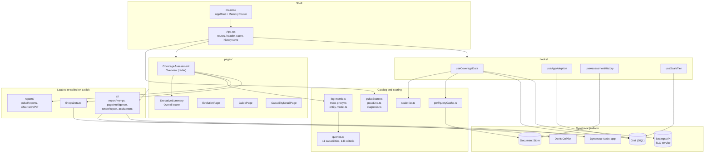
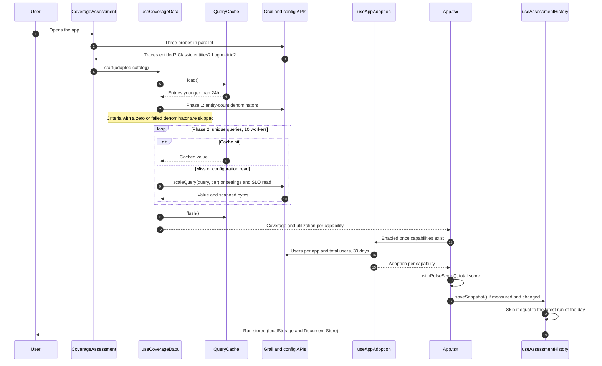
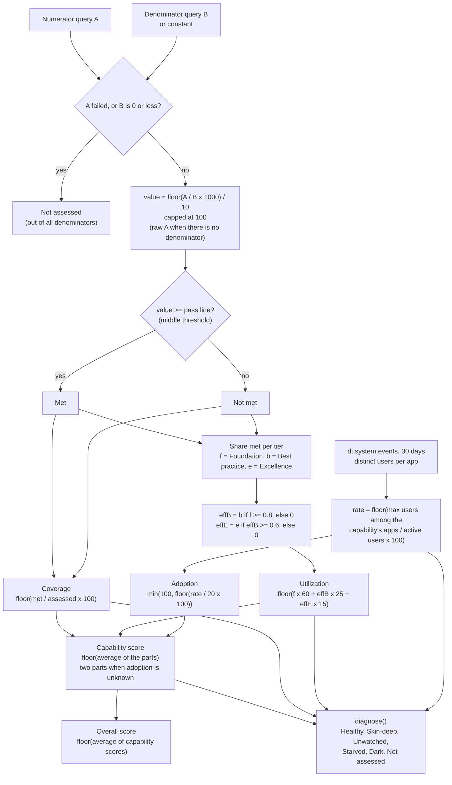
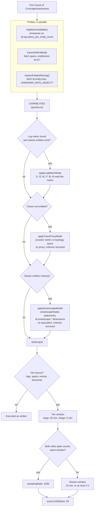
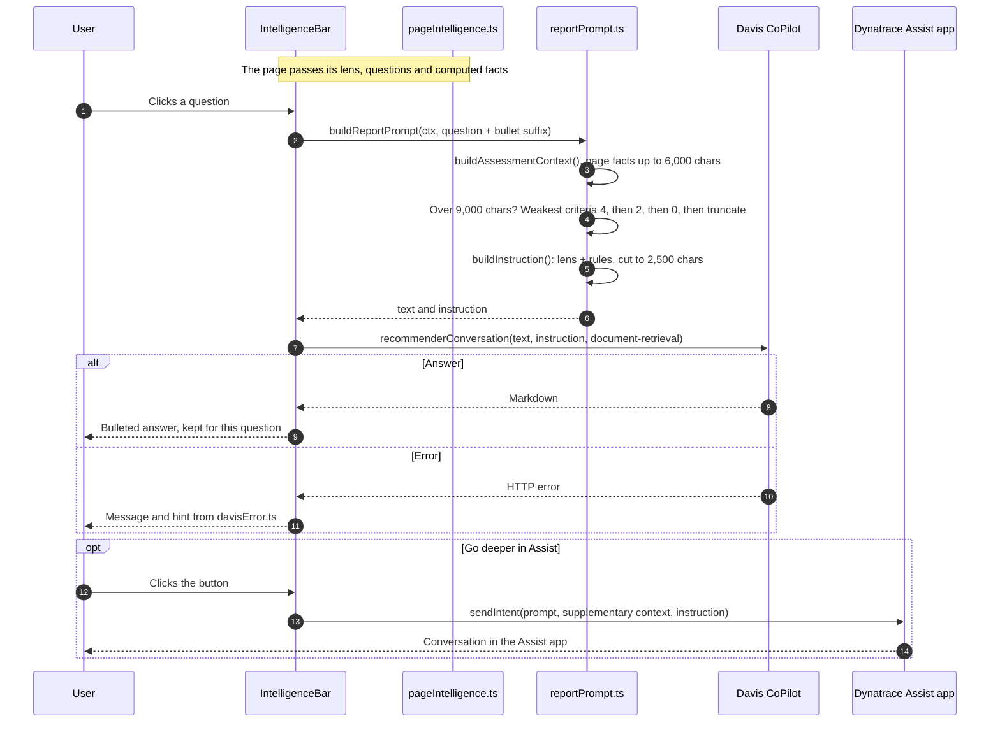
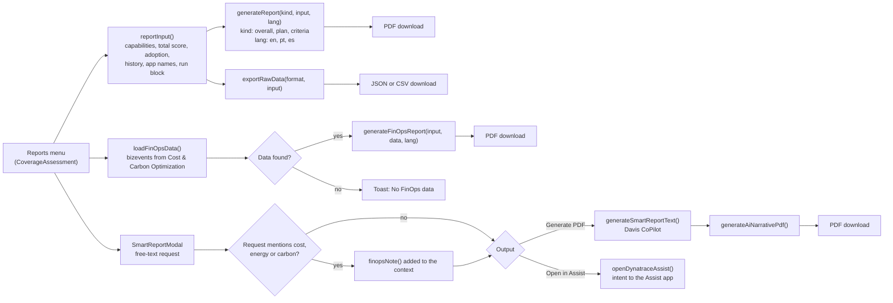

# Architecture diagrams

Mermaid diagrams for Pulse Assessment 3.0.8. Each one follows the code under `ui/app/`; the text reference is [ARCHITECTURE.md](ARCHITECTURE.md). GitHub and the VS Code Markdown preview (with a Mermaid extension) render them directly.

## 1. Module map

`App.tsx` owns the shared state (history, scale tier, assessment results, adoption) and applies the three-part score once. Pages receive that state as props; they call the AI and report modules only on a click.

## 2. Run flow: from open to saved snapshot

The run starts on the first mount of the Overview page. A run inside 24 hours is answered from the cache document; Refresh empties that document first. The snapshot is saved from `App.tsx` only after adoption has answered, so the saved score has all three parts.

## 3. Scoring pipeline

A criterion that cannot be measured is "not assessed" and leaves every denominator. Coverage and utilization come from `useCoverageData`, adoption from `useAppAdoption`; `withPulseScore()` averages them and `diagnose()` names the result without changing it.

## 4. Environment adaptation: probes to catalog

Three probes decide how the catalog is rewritten before the run. The order is fixed: log metric, then trace proxy, then Smartscape. Each executed query then passes through `scaleQuery()`, which applies the scale tier and the cost rules to hot sources only.

## 5. Dynatrace Intelligence request

One prompt builder serves the Intelligence bar, the Smart Report and the hand-off to Assist. The app computes every number the answer may quote; the instruction is cut to 2,500 characters and the request text is kept under 9,000.

## 6. Reports

The report code and jsPDF are loaded on the first click. All reports read the capability results already on screen; only the FinOps report and a cost-related Smart Report request run additional queries.

