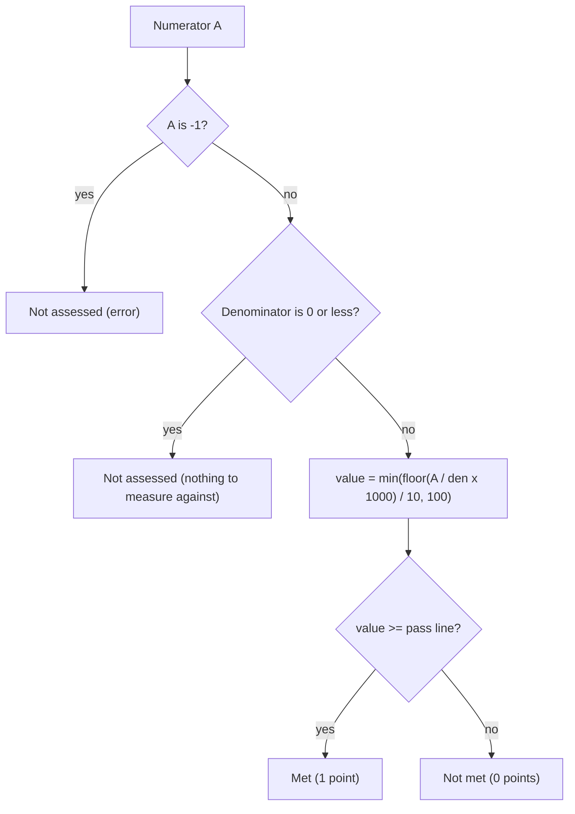

# Pulse Assessment: scoring calculations

How the app turns query results into scores, bands, verdicts and "gain if met" points.
This document describes version 3.0.12 (`app.config.json`). The code is the source of truth;
every section names the file it was checked against.

Summary of the model:

- 11 capabilities, 138 criteria (`ui/app/queries.ts`).
- Each criterion ends in one of three states: met, not met, not assessed.
- Each capability has three parts on a 0–100 scale: coverage, utilization, adoption.
- Capability score = floor of the average of the parts. Overall score = floor of the average of the capability scores.
- Verdicts read the parts together. They never change a score.

## 1. From a query result to met, not met or not assessed

Source: `ui/app/hooks/useCoverageData.ts` (`extractValue`, `executeDql`, the criterion loop in `runAssessment`), `ui/app/passLine.ts`.

### 1.1 Reading a number from a query

| Situation | Number used |
|---|---|
| Query succeeded with records | First numeric field of the first record. An array field (a timeseries) gives its last numeric element |
| Query succeeded with no records, or no numeric field | `0` |
| Query failed, was cancelled, returned no result, or threw | `-1` (error sentinel) |
| `settings:count <schema>` and `slos:count` | A count of configuration objects read from the settings and SLO services; `-1` when they cannot be read |
| Numerator skipped because its entity-count denominator is `0` or failed | Not executed, so it reads as `-1` |

### 1.2 Value of the criterion

`A` is the numerator (`query`). The denominator is `queryB` when present, otherwise `denominatorConstant`.

| Criterion shape | Count in catalog | Value |
|---|---|---|
| `queryB` (ratio of two queries) | 93 | `min(floor(A / B × 1000) / 10, 100)` |
| `denominatorConstant = N` | 45 | `min(floor(A / N × 1000) / 10, 100)` |
| Neither | 0 | `A` as returned |

The value is a percentage with one decimal, floored and capped at 100. A constant of `1` (37 criteria)
makes a presence check: any count of 1 or more reads 100. A constant of `100` (7 criteria) means the
query already returns a percentage.

### 1.3 State



A failed denominator query (`-1`) and an empty one (`0`) are treated the same way: not assessed.

### 1.4 Threshold rule (pass line)

Each criterion lists one, two or three targets. One of them is the pass line; the others do not affect the score.

`passLine = sortedDescending[floor((n − 1) / 2)]`

| Targets listed | Criteria | Pass line | Example |
|---|---|---|---|
| 3 | 71 | The middle one | 80 / 50 / 1 → 50 |
| 2 | 8 | The higher one | 60 / 30 → 60 |
| 1 | 64 | That one | 100 → 100 |

A criterion is met when `value >= passLine`. The default mode is `"middle"` (`PASS_LINE_DEFAULT`).

Because the value is floored to one decimal, a reading of 49.91% is 49.9 and does not meet a pass line of 50.

## 2. Coverage

Source: `ui/app/hooks/useCoverageData.ts` (`capScore`, `assessedCount`, `notAssessedCount`).

```
assessed = criteria in the capability − not assessed
coverage = floor(met / assessed × 100)        (0 when assessed = 0)
```

Not assessed criteria leave the denominator. They are reported and never counted as failures.

## 3. Utilization

Source: `ui/app/hooks/useCoverageData.ts` (`tierCounts`, `FOUNDATION_WEIGHT`, `BEST_PRACTICE_WEIGHT`, `EXCELLENCE_WEIGHT`), `ui/app/data/criterionTiers.ts`.

### 3.1 Tiers

Every criterion belongs to one tier (`CRITERION_TIERS`; an id missing from the map falls back to Foundation).
Not assessed criteria are left out of the tier totals as well.

In the 3.0.12 catalog every capability has criteria in all three tiers. Application Security, Threat Observability,
Software Delivery and Platform Governance have a single Foundation criterion, so their Foundation share is 0 or 1.

### 3.2 Formula

```
f = Foundation met / Foundation assessed          (0 when none assessed)
b = Best practice met / Best practice assessed    (0 when none assessed)
e = Excellence met / Excellence assessed          (0 when none assessed)

effB = b  if f    >= 0.8  else 0
effE = e  if effB >= 0.6  else 0

utilization = floor(f × 60 + effB × 25 + effE × 15)
```

| Tier | Weight | Counts when |
|---|---|---|
| Foundation | 60 | Always |
| Best practice | 25 | Foundation is at 80% or more |
| Excellence | 15 | Best practice counts and is at 60% or more |

The Excellence gate reads the effective Best practice share, so a closed Foundation gate closes both.

### 3.3 Empty tier

A tier with nothing assessed has a share of 0. Its weight is not redistributed.

| Empty tier | Effect | Highest utilization possible |
|---|---|---|
| Foundation | `f = 0`, the Foundation gate stays closed, nothing counts | 0 |
| Best practice | `effB = 0`, the Excellence gate stays closed | 60 |
| Excellence | Its 15 points cannot be earned | 85 |

With the 3.0.12 catalog a tier is empty only when all of its criteria are not assessed. Where Foundation
has a single criterion and it is not assessed, utilization is 0.

## 4. Adoption

Source: `ui/app/hooks/useAppAdoption.ts`, `ui/app/data/appCapabilityMap.ts`, `ui/app/pulseScore.ts` (`adoptionPoints`, `ADOPTION_FULL_RATE`).

### 4.1 Reading

Both readings come from query execution events in the system events table, over the last 30 days,
excluding service accounts.

| Reading | Definition |
|---|---|
| Active users | Distinct users who ran at least one query, through any app or none |
| Users per app | Distinct users per application context, excluding the platform shell; the 200 apps with most users |

Each app id is mapped to one capability: Workflows and Dynatrace Assist have no primary capability and go to
"Other apps", which feeds no score; then an explicit list of app ids decides; then the first matching keyword
in the app id; anything else goes to "Other apps".

An app can be listed under further capabilities on screen (`SHARED`), but only its primary mapping feeds adoption.

### 4.2 Rate and points

```
users = largest user count among the apps mapped to the capability   (not the union)
rate  = min(100, floor(users / activeUsers × 100))
adoption = min(100, floor(rate / 20 × 100))
```

Since `rate` is a whole percentage, adoption moves in steps of 5: 1% → 5, 12% → 60, 20% or more → 100.
A capability with no mapped app in use has `rate = 0` and adoption 0.

### 4.3 When adoption is not measured

Adoption is "not measured" for every capability, never 0, when the per-app query fails or returns no rows,
or when the active-user count is missing or 0. While the reading is loading the score is provisional
(`scoreSettled = false`) and the run is saved to history only after adoption answers.

## 5. Capability and overall score

Source: `ui/app/pulseScore.ts` (`withPulseScore`), `ui/app/App.tsx`.

| Adoption | Capability score |
|---|---|
| Measured | `floor((coverage + utilization + adoption) / 3)` |
| Not measured | `floor((coverage + utilization) / 2)` |

```
overall = floor(sum of capability scores / number of capabilities)     (0 with no capabilities)
```

The overall score averages the already-floored capability scores. It is not recomputed from criteria,
and a capability where nothing could be assessed still counts in the average with coverage 0 and utilization 0.

## 6. Score bands

Source: `ui/app/utils/colors.ts` (`scoreBand`, `SCORE_BANDS`).

| Band | Score |
|---|---|
| Excellent | 80–100 |
| Good | 60–79 |
| Moderate | 40–59 |
| Low | 20–39 |
| N/A | 0–19 |

The same bands apply to the overall score, a capability score and each part.

## 7. Verdicts

Source: `ui/app/diagnosis.ts` (`diagnose`, `DEFAULT_CUTS`, `DIAGNOSIS_META`); inputs as passed in `ui/app/pages/CapabilityDetailPage.tsx`.

Cuts (`DEFAULT_CUTS`):

| Name | Test |
|---|---|
| High coverage | `coverage >= 60` |
| Deep | `utilization >= 60` |
| High adoption | `rate >= 12` (% of active users, which is 60 adoption points) |

`adoptionFloor` is set to infinity, so a head count alone never makes adoption high.

Rules, in the order the code evaluates them. The first match wins.

| # | Id | Label | Rule |
|---|---|---|---|
| 1 | `notAssessed` | Not assessed | Not assessed criteria >= total criteria of the capability |
| 2a | `healthy` | Healthy | Adoption not measured, high coverage and deep |
| 2b | `skinDeep` | Skin-deep | Adoption not measured, high coverage, not deep |
| 2c | `dark` | Dark | Adoption not measured, coverage not high |
| 3 | `starved` | Starved | High adoption, coverage not high |
| 4 | `unwatched` | Unwatched | High coverage, adoption not high |
| 5 | `skinDeep` | Skin-deep | High coverage, high adoption, not deep |
| 6 | `healthy` | Healthy | High coverage, high adoption (and therefore deep) |
| 7 | `dark` | Dark | Everything else: coverage not high and adoption not high |

Utilization is not read for Starved, Unwatched or Dark. Lists sort verdicts by urgency (`rank`):
Unwatched, Starved, Skin-deep, Dark, Healthy, Not assessed.

## 8. Gain if met

Source: `ui/app/pulseScore.ts` (`gainIfMet`); per-overall division in `ui/app/pages/ExecutiveSummary.tsx`, `ui/app/ai/pageIntelligence.ts` (`gains`) and `ui/app/reports/pulseReports.ts`.

The gain estimates how much the capability score would rise if that one unmet criterion were met
and nothing else changed. It is internal: it orders the actions and decides the gain icon. No
screen, Dynatrace Intelligence answer or report shows the figure.

```
coverageGain    = 100 / assessed                         (not floored)
utilizationGain = utilization with one more criterion met in that tier − utilization now
                  (both floored, same weights and gates as section 3)
parts           = 3 if adoption is measured, else 2

gain (capability) = max(0, floor1((coverageGain + utilizationGain) / parts))
gain (overall)    = floor1(gain (capability) / number of capabilities)
```

`floor1` floors to one decimal: a gain is never shown larger than it is. Adoption does not change in this estimate.

| Consequence | Why |
|---|---|
| Criteria of the same tier in a capability show the same gain | Only the tier enters the computation |
| A criterion that opens a gate shows a large gain | Tiers behind the gate start counting in `utilizationGain` |
| A criterion behind a closed gate shows only its coverage share | `utilizationGain` is 0 |
| The gain is an estimate | The real score floors coverage and the final average; the gain does not |
| Gains do not add up exactly | Each one is computed with every other criterion unchanged |

The capability page orders its actions by the capability gain. The Overall score page, the
reports and the Dynatrace Intelligence facts order theirs by the overall gain.

## 9. Worked examples

Both examples use invented readings. Every step follows the formulas above.

### 9.1 Example A: gates open, one criterion not assessed

A capability with 15 criteria (Foundation 3, Best practice 6, Excellence 6). The platform has 412 active users.

Two criterion readings:

| Criterion | A | B | Value | Targets | Pass line | State |
|---|---|---|---|---|---|---|
| Ratio 1 | 77 | 571 | `floor(134.85) / 10 = 13.4` | 30 / 10 / 1 | 10 | Met |
| Ratio 2 | 285 | 571 | `floor(499.12) / 10 = 49.9` | 80 / 50 / 1 | 50 | Not met |
| Ratio 3 (Excellence) | 4 | 0 | none | 30 / 10 / 1 | 10 | Not assessed |

Tier results after all criteria:

| Tier | Assessed | Met | Share |
|---|---|---|---|
| Foundation | 3 | 3 | 1.000 |
| Best practice | 6 | 4 | 0.667 |
| Excellence | 5 | 2 | 0.400 |
| Total | 14 | 9 | |

| Step | Computation | Result |
|---|---|---|
| Coverage | `floor(9 / 14 × 100) = floor(64.28)` | 64 |
| Foundation gate | `1.000 >= 0.8` | Open, `effB = 0.667` |
| Best practice gate | `0.667 >= 0.6` | Open, `effE = 0.400` |
| Utilization | `floor(1 × 60 + 0.667 × 25 + 0.4 × 15) = floor(60 + 16.67 + 6) = floor(82.67)` | 82 |
| Adoption users | Largest app audience: 39 | 39 |
| Adoption rate | `floor(39 / 412 × 100) = floor(9.47)` | 9 |
| Adoption | `min(100, floor(9 / 20 × 100))` | 45 |
| Capability score | `floor((64 + 82 + 45) / 3) = floor(63.67)` | 63 |
| Band | 60–79 | Good |
| Verdict | Coverage 64 >= 60, rate 9 < 12 | Unwatched |

Gain if met:

| Unmet criterion in | Coverage gain | Utilization then | Utilization gain | Capability gain | Overall gain (11 capabilities) |
|---|---|---|---|---|---|
| Best practice | `100 / 14 = 7.14` | `floor(60 + 5/6 × 25 + 6) = floor(86.83) = 86` | 4 | `(7.14 + 4) / 3 = 3.71 → 3.7` | `3.7 / 11 → 0.3` |
| Excellence | 7.14 | `floor(60 + 16.67 + 3/5 × 15) = floor(85.67) = 85` | 3 | `(7.14 + 3) / 3 = 3.38 → 3.3` | `3.3 / 11 → 0.3` |

### 9.2 Example B: Foundation gate closed

A capability with 16 criteria (Foundation 3, Best practice 9, Excellence 4), all assessed. 412 active users.

| Tier | Assessed | Met | Share |
|---|---|---|---|
| Foundation | 3 | 2 | 0.667 |
| Best practice | 9 | 6 | 0.667 |
| Excellence | 4 | 1 | 0.250 |
| Total | 16 | 9 | |

| Step | Computation | Result |
|---|---|---|
| Coverage | `floor(9 / 16 × 100) = floor(56.25)` | 56 |
| Foundation gate | `0.667 >= 0.8` is false | Closed, `effB = 0` |
| Best practice gate | `effB = 0 >= 0.6` is false | Closed, `effE = 0` |
| Utilization | `floor(0.667 × 60 + 0 + 0) = floor(40.00)` | 40 |
| Adoption users | Largest app audience: 61 | 61 |
| Adoption rate | `floor(61 / 412 × 100) = floor(14.81)` | 14 |
| Adoption | `min(100, floor(14 / 20 × 100))` | 70 |
| Capability score | `floor((56 + 40 + 70) / 3) = floor(55.33)` | 55 |
| Band | 40–59 | Moderate |
| Verdict | Rate 14 >= 12, coverage 56 < 60 | Starved |

The six Best practice criteria and the Excellence criterion that are met add nothing to utilization while the gate is closed.

Gain if met:

| Unmet criterion in | Coverage gain | Utilization then | Utilization gain | Capability gain | Overall gain (11 capabilities) |
|---|---|---|---|---|---|
| Foundation | `100 / 16 = 6.25` | Gates open: `floor(60 + 0.667 × 25 + 0.25 × 15) = floor(80.42) = 80` | 40 | `(6.25 + 40) / 3 = 15.42 → 15.4` | `15.4 / 11 → 1.4` |
| Best practice | 6.25 | Gate still closed: 40 | 0 | `6.25 / 3 = 2.08 → 2.0` | `2.0 / 11 → 0.1` |
| Excellence | 6.25 | Gate still closed: 40 | 0 | 2.0 | 0.1 |

Check against the real score if the Foundation criterion is met: coverage `floor(10 / 16 × 100) = 62`,
utilization 80, adoption 70, score `floor(212 / 3) = 70`. The real change is 15; the estimate shown is 15.4.

Same capability when adoption cannot be read:

| Step | Computation | Result |
|---|---|---|
| Capability score | `floor((56 + 40) / 2)` | 48 |
| Verdict | Adoption not measured, coverage 56 < 60 | Dark |
| Gain, Foundation criterion | `(6.25 + 40) / 2 = 23.13` | 23.1 |

### 9.3 Overall score

Eleven capability scores: 63, 55, 71, 48, 30, 12, 0, 44, 58, 66, 39.

`overall = floor(486 / 11) = floor(44.18) = 44`, band Moderate.

## 10. Edge cases handled in code

| Case | Behaviour | Source |
|---|---|---|
| Numerator query fails | Criterion is not assessed and flagged as an error | `useCoverageData.ts` |
| Denominator is 0 or failed | Criterion is not assessed | `useCoverageData.ts` |
| Entity-count denominator is 0 | The numerator is not executed; the criterion is not assessed | `useCoverageData.ts` |
| Numerator larger than denominator | Value capped at 100 | `useCoverageData.ts` |
| Query returns no records | Reads 0: not met as a numerator, not assessed as a denominator | `useCoverageData.ts` |
| Nothing assessed in a capability | Coverage 0, utilization 0, verdict Not assessed; the capability still counts in the overall average | `useCoverageData.ts`, `diagnosis.ts`, `App.tsx` |
| Nothing assessed in any capability | The run is not saved to history | `App.tsx` |
| Tier with nothing assessed | Share 0; gates behind it stay closed | `useCoverageData.ts` |
| Floating-point error at a whole number | `1e-9` is added before the floor of coverage and utilization | `useCoverageData.ts` |
| Adoption query fails, returns no rows, or active users is 0 | Adoption not measured; two-part score; verdict from coverage and utilization only | `useAppAdoption.ts`, `pulseScore.ts`, `diagnosis.ts` |
| Adoption measured, capability has no mapped app in use | Rate 0, adoption 0, still a three-part score | `pulseScore.ts` |
| App count above the active-user count | Rate capped at 100 | `useAppAdoption.ts` |
| Rate above 20% | Adoption capped at 100 | `pulseScore.ts` |
| Negative gain | Shown as 0 | `pulseScore.ts` |
| Rollback switches | `?passline=lowest` (lowest target decides), `?accuracy=legacy` (not assessed counts as failed), `PULSE_SCORE_PARTS = "coverage"` (coverage-only score). All off by default | `passLine.ts`, `useCoverageData.ts`, `pulseScore.ts` |
